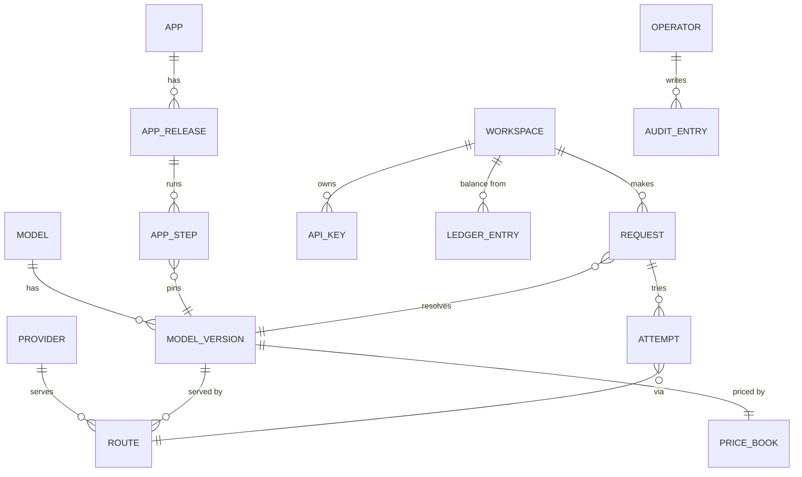
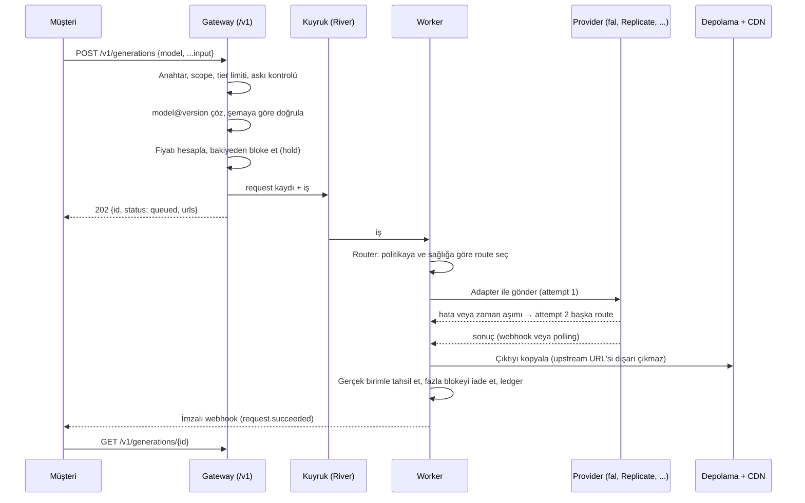

# Modelvend platform mimarisi (öneri)

> Durum: öneri, 16 Ekim 2026. Admin paneli (`apps/admin`) bu belgedeki domain modelini kullanıyor; backend henüz yok.
> Kaynaklar: OpenRouter ve fal.ai'nin herkese açık dokümanları (bölüm 2'de linkli), postpane'in mevcut Go altyapısı.

## 1. Kısaca

Modelvend, OpenRouter ve fal.ai'nin arasında duruyor:

- **OpenRouter gibi:** Tek API ve tek bakiyeyle, çoğunlukla üçüncü taraf sağlayıcılardaki (fal, Replicate, Google, OpenAI, ElevenLabs, Kling, …) modelleri satıyoruz. Bir model birden çok sağlayıcıdan servis edilebiliyor. Hangisinin kullanılacağına router karar veriyor.
- **fal.ai gibi:** İşimiz çoğunlukla medya: görsel, video, ses ve 3D. Bu işler uzun sürüyor. Bu yüzden asenkron bir kuyruk API'si, webhook ve çıktıların bizim CDN'imizde barındırılması gerekiyor. Her model sürümünün JSON Schema ile tanımlı bir girdisi ve çıktısı var.
- **İkisinde de olmayan:** Hazır **app**'ler var. Bunlar katalog modellerini sabitlenmiş sürümlerle zincirleyen iş akışları. Her app'in kendi fiyatı ve kendi release'leri var.

Önerinin temel kararları:

1. **Model, sürüm ve route ayrı kavramlar.**
   - Model, kalıcı kimliktir (`google/veo-3.1`).
   - Sürüm, değişmez bir yayındır (`@v2`). Şeması ve fiyatı yayından sonra değişmez.
   - Route, o sürümün bir sağlayıcıdaki karşılığıdır: sağlayıcının model ID'si, bize maliyeti, önceliği ve sağlık durumu.
   - Kendi GPU'larımız ileride sadece yeni bir sağlayıcı türü (`managed`) olarak eklenir.
2. **Sürüm yaşam döngüsü:** `draft → staging → live → deprecated → retired`. Bunun üstünde model seviyesinde bir acil durdurma (pause) var. App'ler numaralı release'lerle deploy ve rollback edilir.
3. **İki dış API yüzeyi var, arkada tek motor çalışır:**
   - OpenAI uyumlu yüzey: `/v1/chat/completions`, `/v1/images/generations`, `/v1/models`. postpane Modelvend'i bugün zaten böyle çağırıyor.
   - Yerel medya yüzeyi: `POST /v1/generations`, durum sorgulama, webhook. Müşteri konsolundaki kod örnekleri bunu gösteriyor.
4. **Backend Go ile, postpane'deki yapıyla aynı:** Postgres, River kuyruğu, worker pool'ları ve Helm. Admin paneli postpane'deki gibi ayrı bir uygulama. Tarayıcı `/api/*` isteklerini admin API'ye iletir.
5. **Para mikro-dolar olarak saklanır** (integer, 1e-6 USD). Ön ödemeli kredi, istek başında bloke edilen tutar, gerçek kullanım üzerinden tahsilat ve append-only bir ledger.

## 2. OpenRouter ve fal.ai nasıl kurgulanmış

| Konu                 | OpenRouter                                                                                                                                                                                                                | fal.ai                                                                                                                                                              | Modelvend kararı                                                                                                                                                                           |
| -------------------- | ------------------------------------------------------------------------------------------------------------------------------------------------------------------------------------------------------------------------- | ------------------------------------------------------------------------------------------------------------------------------------------------------------------- | ------------------------------------------------------------------------------------------------------------------------------------------------------------------------------------------ |
| Kimlik               | `author/slug`. Kalıcı bir `canonical_slug`, `~author/x-latest` gibi takma adlar ve `:free` / `:nitro` gibi varyantlar var.                                                                                                | Endpoint ID'si `owner/app/path`, örneğin `fal-ai/flux/dev`.                                                                                                         | `publisher/slug` ve sabitlemek için `@version`. Sürüm verilmezse varsayılan sürüm kullanılır.                                                                                              |
| Katalog              | `/api/v1/models` modalite, fiyat, desteklenen parametreler ve `expiration_date` döndürür.                                                                                                                                 | `/v1/models` kategori ve `status: active\|deprecated` döndürür. Her endpoint için bir OpenAPI şeması var.                                                           | `/v1/models` ve sürüm başına JSON Schema. Dokümanlar, playground formu ve SDK tipleri şemadan üretilir.                                                                                    |
| Sağlayıcı ↔ model    | Bir modelin N endpoint'i var. Her endpoint'in kendi fiyatı, kuantizasyonu, uptime değerleri (5 dk / 30 dk / 1 gün) ve p50–p99 gecikmesi var.                                                                              | Kendi altyapısında çalıştırıyor.                                                                                                                                    | Sürüm başına N route. Her route'un maliyeti, önceliği, ağırlığı ve sağlık penceresi var.                                                                                                   |
| Routing              | `provider{order, only, ignore, allow_fallbacks, sort, max_price}`. Varsayılanda son 30 saniyede hata veren sağlayıcılar dışarıda kalır ve kalanlar 1/fiyat² ağırlığıyla seçilir. `models[]` ile model yedeği verilebilir. | Yok.                                                                                                                                                                | Sürüm başına bir politika: `priority`, `cheapest`, `fastest` veya `weighted`. Fallback ve deneme sayısı da politikada. Müşteri tarafı `provider{only, ignore, max_price}` ileride eklenir. |
| Async                | Video için `POST /videos` 202 ve `polling_url` döner. Durumlar `pending`, `in_progress`, `completed`, `failed`. Webhook'lar HMAC ile imzalı.                                                                              | `queue.fal.run` isteği alınca `request_id`, `status_url` ve `cancel_url` döner. Durumlar `IN_QUEUE`, `IN_PROGRESS`, `COMPLETED`. SSE ve Ed25519 imzalı webhook var. | `req_…` ID'si ve durumlar `queued`, `running`, `succeeded`, `failed`, `canceled`. İmzalı webhook ve idempotency anahtarı.                                                                  |
| Çıktılar             | İmzalı URL'ler süreli.                                                                                                                                                                                                    | `fal.media` CDN'inde, süresi ayarlanabilir. Replicate çıktıları 1 saatte siler.                                                                                     | Upstream çıktısı her zaman **bizim** depolamamıza kopyalanır. Müşteriye upstream URL'si asla verilmez.                                                                                     |
| Sürümler             | `expiration_date` ile "gidiyor" rozeti, sonra katalogdan çıkarma.                                                                                                                                                         | Her deploy değişmez bir revision oluşturur. App adı aktif revision'a işaret eder ve `set-rev` ile rollback yapılır.                                                 | Modellerde yaşam döngüsü, `Deprecation` / `Sunset` header'ları ve bir yerine geçen sürüm. App'lerde numaralı release ve rollback.                                                          |
| Kendi GPU'muz        | Yok.                                                                                                                                                                                                                      | `fal.App`: `machine_type`, `keep_alive`, `min_concurrency` / `max_concurrency`. Fiyatlandırma GPU-saniye başına.                                                    | Sonraya bırakıldı. Gelince `managed` türünde bir sağlayıcı olur; deploy, revision ve ölçekleme ayarları onun altında tutulur.                                                              |
| Anahtarlar ve fatura | Anahtar başına harcama limiti (`limit`, `limit_reset`). Ayrı bir management key ile anahtar oluşturma API'si. Bakiye bitince 402 ve `limit_source`. Her yanıtta `usage.cost`.                                             | Preset ve izinlerden oluşan anahtar yetkileri. 5xx ve kuyruk süresi faturalanmaz.                                                                                   | Workspace bakiyesi, anahtar başına aylık limit, tier limitleri, 402 `insufficient_credits`. Başarısız istek ve kuyruk süresi faturalanmaz.                                                 |

Kaynaklar:

- OpenRouter: [models](https://openrouter.ai/docs/overview/models), [endpoints](https://openrouter.ai/docs/api/api-reference/endpoints/list-endpoints), [provider routing](https://openrouter.ai/docs/features/provider-routing), [video](https://openrouter.ai/docs/guides/overview/multimodal/video-generation.md), [keys](https://openrouter.ai/docs/guides/overview/auth/provisioning-api-keys), [usage](https://openrouter.ai/docs/guides/guides/usage-accounting)
- fal: [queue](https://fal.ai/docs/model-apis/model-endpoints/queue), [webhooks](https://fal.ai/docs/model-apis/webhooks), [models API](https://fal.ai/docs/platform-apis/v1/models), [pricing](https://fal.ai/docs/documentation/model-apis/pricing), [serverless](https://fal.ai/docs/serverless/introduction), [revisions](https://fal.ai/docs/platform-apis/v1/serverless/apps/revisions.md)
- Replicate (karşılaştırma için): [HTTP API](https://replicate.com/docs/reference/http), [deployments](https://replicate.com/docs/topics/deployments)

## 3. Domain modeli



Kavramlar:

- **Provider:** Çıkarım hizmetini veren taraf. Üç türü var:
  - `aggregator`: fal, Replicate.
  - `first_party`: OpenAI, Google Vertex, ElevenLabs, Kling.
  - `managed`: bizim GPU'larımız.

  Her sağlayıcının bir **adapter**'ı vardır. Adapter, hangi protokolle konuşulacağını belirler: `fal`, `replicate`, `openai`, `vertex`, `elevenlabs`, `runway` veya `http`. API anahtarı şifreli saklanır ve yalnızca son birkaç karakteri gösterilir. Sağlayıcının eşzamanlılık ve RPM limitleri, sağlık durumu ve durdurma anahtarı vardır.

- **Model:** Müşterinin çağırdığı kalıcı kimlik, `publisher/slug`. Katalog bilgilerini taşır: ad, açıklama, modalite, görevler (`text-to-video`, …) ve rozetler.
  - Görünürlük: `public`, `unlisted` veya `private`.
  - Model başına bir **kill switch**: `state: active|paused`. Model durdurulursa tüm sürümleri 503 `model_paused` döndürür.
  - `defaultVersion`, sürüm belirtmeyen isteklerin hangi sürüme gideceğini söyler.
- **ModelVersion:** Değişmez bir yayın.
  - JSON Schema ile tanımlı girdi ve çıktı.
  - Fiyat listesi: birim, kademeler (tier), girdi fiyatı ve promosyon.
  - Routing politikası ve route'lar.
  - Değişiklik notu (changelog).
  - Sunset tarihi ve yerine geçecek sürüm.
- **Route:** Bir sürümün bir sağlayıcıdaki karşılığı.
  - Sağlayıcının kendi model ID'si (`upstreamModel`), örneğin `fal-ai/kling-video/v3/pro/text-to-video`.
  - `priority` ve `weight`.
  - **Maliyet:** Sağlayıcıya birim başına ödediğimiz tutar. Marj bundan hesaplanır.
  - Durum: `active`, `paused` veya `draining`. Ayrıca bölge, eşzamanlılık limiti ve sağlık bilgisi.
- **App / AppRelease / AppStep:** App, adımları olan bir iş akışıdır. Her adım `model@version` şeklinde **sabitlenir**. Model yeni bir sürüm çıkardığında canlı app etkilenmez; yeni sürümü kullanmak için app'in yeni bir release'i gerekir. Release başına sabit bir çalıştırma fiyatı vardır. Deploy ve rollback, fal'daki revision ve takma ad mantığıyla çalışır.
- **Workspace:** Faturalanan hesap. Bakiyesi, tier'ı (`free`, `standard`, `scale`, `enterprise`), limit override'ları ve askıya alma durumu burada tutulur. Kullanıcılar workspace'in üyesidir.
- **ApiKey:** `mv_live_…` veya `mv_test_…` biçiminde. Secret yalnızca bir kez gösterilir; veritabanında hash'i ve prefix'i saklanır. Her anahtarın scope'ları (model veya app ID'leri), aylık harcama limiti ve iptal durumu vardır.
- **Request / Attempt:** Her API çağrısı bir `req_…` kaydı oluşturur. Router her denemeyi bir **attempt** olarak kaydeder: sağlayıcı, route, upstream ID, sonuç ve gecikme. Bu, OpenRouter'daki `provider_responses[]` alanının karşılığı. Yalnızca başarılı attempt faturalanır.
- **LedgerEntry:** Bakiyeyi oluşturan append-only kayıt: `top_up`, `grant`, `usage`, `refund`, `adjustment`. Bakiye bu kayıtların toplamıdır. Hızlı okumak için ayrıca önbelleğe alınır.
- **Operator / AuditEntry:** Admin paneli müşteri hesaplarından tamamen ayrıdır. Her değişiklik audit log'a yazılır.

### Kimlik ve sürüm çözümleme

```
google/veo-3.1            → defaultVersion (örneğin v2)
google/veo-3.1@v1         → v1 (deprecated ise yanıt Deprecation/Sunset header'ı taşır)
google/veo-3.1@v0         → retired: replacement varsa ona yönlendirilir, yoksa 410
modelvend/lumen-1@staging → yalnızca dahili anahtarlarla
```

### Yaşam döngüleri

```mermaid
stateDiagram-v2
  [*] --> draft
  draft --> staging: promote
  draft --> live: promote (aktif route ve fiyat şart)
  staging --> live: promote
  live --> deprecated: deprecate (default olamaz; sunset ve replacement)
  deprecated --> retired: retire (geri alınamaz)
  retired --> [*]
```



- **draft:** Kimse çağıramaz. Şema, fiyat ve route'lar serbestçe düzenlenir.
- **staging:** Yalnızca dahili ve test anahtarları çağırabilir. Gerçek sağlayıcıyla uçtan uca test için kullanılır.
- **live:**
  - Şema ve fiyat **dondurulur**. Değiştirmek için yeni sürüm açılır.
  - Route'lar, routing politikası ve changelog yine değiştirilebilir.
  - Sürümün canlıya alınması onu otomatik olarak default yapmaz; default ayrıca seçilir.
- **deprecated:** Sunset tarihine kadar çalışmaya devam eder. Yanıtlarda `Deprecation` ve `Sunset` header'ları olur. Son 30 günde bu sürümü çağıran workspace'lere e-posta gider.
- **retired:** Artık çağrılamaz. İstekler yerine geçen sürüme yönlendirilir; o yoksa 410 döner.
- **Model pause:** Sürümlerden bağımsız acil durdurma. Kuyruktaki işler tamamlanır.
- **Provider pause:** O sağlayıcının tüm route'ları atlanır ve istekler sıradaki route'a düşer.
- **Route pause/drain:** Tek bir sürüm-sağlayıcı ikilisini durdurur. `draining` durumundaki route elindeki işleri bitirir ama yenisini almaz.

## 4. İstek akışı



Ayrıntılar:

- **Senkron ve kuyruklu.** Görsel, TTS ve LLM gibi kısa işler varsayılan olarak senkron yanıt verir. Senkron mod `Prefer: wait=60` gibi bir header ile en fazla 60 saniye bekler, sonra 202 döner. Video ve 3D her zaman kuyruğa girer. İki durumda da aynı `req_…` kaydı kullanılır.
- **OpenAI uyumlu yüzey.** `/v1/chat/completions` ve `/v1/images/generations` aynı motorun ince bir çevirisidir. `model` alanı `publisher/slug[@version]` biçimindedir. postpane'in `internal/modelvend` istemcisi bu yüzeyi zaten kullanıyor.
- **Durumlar:** `queued → running → succeeded | failed | canceled`. fal'dakinin aksine hata ayrı bir durumdur, `COMPLETED` içinde bir alt durum değildir.
- **Webhook.** Gövde `t=<unix>,v1=<hmac-sha256>` ile imzalanır, header'da `Modelvend-Signature` olarak gönderilir. Idempotency anahtarı `<id>-<status>` biçimindedir. Başarısız teslimat 24 saat boyunca üstel bekleme ile yeniden denenir. Özel IP'lere ve yönlendirmelere teslim yapılmaz.
- **İstek idempotency'si.** Müşteri `Idempotency-Key` gönderirse aynı anahtar 24 saat boyunca aynı `req_…` kaydını döndürür.
- **Çıktı saklama.** Varsayılan süre workspace başına 30 gündür ve değiştirilebilir. URL'ler imzalıdır veya CDN üzerinden herkese açıktır.
- **Faturalanmayanlar:** Başarısız istekler, kuyrukta geçen süre ve yalnızca 5xx dönen attempt'ler.
- **İptal.** `POST /v1/generations/{id}/cancel` iptal eder. Upstream işi başladıysa sağlayıcı kurallarına göre ücret oluşabilir; bu durum attempt kaydında görünür.

### Routing

Router her attempt öncesinde şu adımları uygular:

1. **Adayları belirle.** Sürümün `active` route'larını al. Sağlayıcısı `paused` veya `disabled` olanları çıkar. Eşzamanlılık limiti dolmuş olanları da çıkar.
2. **Sağlığı değerlendir.** Son 30 saniye, 5 dakika ve 1 saatlik pencerelerde 5xx ve zaman aşımı oranına bakılır; istemci hataları (4xx) bu orana sayılmaz. Eşiği aşan route için devre kesici açılır ve route bir süre atlanır.
3. **Stratejiye göre sırala.**
   - `priority`: priority alanına göre sırala.
   - `cheapest`: maliyete göre sırala.
   - `fastest`: p50 gecikmesine göre sırala.
   - `weighted`: aynı priority içinde weight oranında rastgele seç.
4. **Gerekirse sonraki adaya geç.** Fallback açıksa ve sağlayıcı henüz çıktı üretmediyse, `maxAttempts` sınırına kadar sıradaki adayla denenir.

Müşteri tarafında OpenRouter'daki `provider{only, ignore, max_price}` karşılığı ileride eklenebilir. Model düzeyinde yedek de (`models: [...]`) daha sonra eklenebilir.

### Faturalama

- Para birimi USD'dir ve veritabanında `BIGINT` mikro-dolar olarak tutulur. API'de ondalıklı sayı olarak görünür.
- Fiyat sürümün fiyat listesinden gelir: `birim × kademe fiyatı × (1 − promo)`, varsa girdi fiyatı eklenir. Maliyet, kullanılan route'un `cost` değeridir. Marj `(fiyat − maliyet) ÷ fiyat` formülüyle hesaplanır. Admin paneli negatif marjı kırmızıyla gösterir.
- Bakiye işlemleri:
  - İstek başında tahmini tutar bloke edilir (hold).
  - İş bitince gerçek birim üzerinden tahsil edilir, örneğin üretilen video saniyesi.
  - Fazla bloke iade edilir.
  - Bakiye yetmezse 402 `insufficient_credits` döner.
  - Otomatik yükleme (auto-reload) müşteri konsolunda zaten var.
- Anahtar limiti aşılırsa 402 `key_limit_reached`, workspace aylık tavanı aşılırsa 402 `spend_cap_reached` döner.

## 5. Önerilen repo yapısı

Güncel yapı [structure.md](structure.md) bölüm 3'te: mimari tarz (bounded context'lere bölünmüş modüler monolit), kontrol ve veri düzlemi, dışa açık ve iç yüzeyler, dosya ağacı ve bağımlılık kuralları. Go tarafının ayrıntısı ve ortam değişkenleri [services/README.md](../services/README.md)'de.

Kısaca: müşteri UI'ı `apps/console`, yönetim UI'ı `apps/admin`. Backend `services/` altında tek Go modülü. Dışa açık yüzeyler (`/v1`, OpenAI uyumlu uçlar, `/mcp`) `services/internal/api/public`, iç yönetim yüzeyi (`/admin/v1`) `services/internal/api/admin` altında. İş mantığı bunların dışında, iş alanı başına bir pakette durur.

Neden Go:

- postpane'in API'si, worker'ları ve admin API'si zaten Go, Postgres ve River ile çalışıyor.
- İşletim bilgisi doğrudan taşınabilir: worker pool'ları, KEDA, Helm, audit ve oturum modeli.
- Gateway çoğunlukla HTTP proxy, streaming ve uzun süren poll işi yapıyor. Go bu iş için uygun.

Neden admin ayrı uygulama: Ayrı host'ta çalışır, ayrı oturum modeli ve operatör hesapları vardır, admin API dışarıya hiç açılmaz. Bu, postpane'de denenmiş bir model.

## 6. Müşteri konsolu (apps/console): dosya yapısı

### Bugünkü durum

Konsolun ekranları iyi durumda, ama altındaki yapı gerçek bir backend'e ve yeni katalog modeline hazır değil:

- **Mock'lar her yerde.** 45'ten fazla dosya `@/mocks/*`'ı doğrudan import ediyor: sayfalar, feature bileşenleri, komut menüsü ve `ConsoleProvider`. Backend'e geçmek için değiştirilecek tek bir yer yok.
- **Tipler katalogla uyuşmuyor.** `types/model.ts`'deki `Model` tipinin `slug`'ı, tek bir `price`'ı ve tek bir `provider`'ı var. Publisher, sürüm, sürüm başına fiyat listesi ve route bilgisi yok. Admin'in kullandığı modelle (bölüm 3) aynı şeyi anlatmıyor.
- **Playground kontrolleri elle yazılmış.** `features/models/lib/playground.ts` kontrolleri modaliteye göre sabit tanımlıyor. Yeni bir model eklemek ya da bir modelin parametresi değişmek kod değişikliği gerektiriyor.
- **İki tür state karışık.** `ConsoleProvider` UI durumunu (açık diyalog, live/test seçimi) sunucu verisiyle (bakiye, anahtarlar, kartlar, işlemler) aynı yerde tutuyor.
- **URL sürüm ifade edemiyor.** `/models/[slug]` publisher'ı ve sürümü taşıyamıyor.
- **Playground gerçek istek atmıyor.** Çalıştırma simüle ediliyor ve istek geçmişi de mock'tan geliyor.

### Hedef yapı

```
apps/console/src/
├─ app/                                 Sadece rotalar: layout, page, metadata, hata sınırları
│  ├─ (console)/
│  │  ├─ page.tsx                       Dashboard
│  │  ├─ models/page.tsx                Katalog
│  │  ├─ models/[publisher]/[slug]/     Model sayfası; ?tab= ve ?version= URL'de
│  │  ├─ apps/page.tsx
│  │  ├─ apps/[slug]/page.tsx
│  │  ├─ canvas/
│  │  ├─ requests/page.tsx              (yeni) İstek geçmişi; detay yan panelde (?panel=request:req_…)
│  │  ├─ usage/page.tsx                 Harcama grafikleri (log tablosu requests'e taşınır)
│  │  ├─ api-keys/page.tsx
│  │  ├─ billing/page.tsx
│  │  ├─ settings/                      (yeni) Workspace, üyeler, webhook'lar, limitler
│  │  └─ quickstart/
│  ├─ (auth)/                           (yeni) sign-in, sign-up, invite/[token]
│  └─ api/                              BFF: tarayıcı API anahtarı görmez
│     ├─ generations/route.ts           Playground ve app çalıştırma: POST, GET /:id, SSE durum akışı
│     └─ uploads/route.ts               Referans medya için imzalı yükleme URL'si
├─ features/                            Ürün alanı başına bir klasör; içinde components/, hooks/, lib/
│  ├─ catalog/                          Model kartı, liste, filtreler (bugünkü models/'in katalog kısmı)
│  ├─ model-page/                       Model sayfası sekmeleri
│  ├─ playground/                       Şemadan form, çalıştırma, çıktı, geçmiş
│  ├─ requests/                         İstek listesi ve detay paneli
│  └─ apps/ canvas/ dashboard/ usage/ billing/ api-keys/ settings/ quickstart/
├─ data/                                (yeni) Veri katmanı: feature'lar veriye yalnızca buradan ulaşır
│  ├─ catalog.ts                        listModels, getModel, getVersion, listApps, getApp
│  ├─ requests.ts                       listRequests, getRequest
│  ├─ workspace.ts                      Bakiye, anahtarlar, kartlar, ledger, kullanım
│  ├─ actions/                          Server Action'lar: createKey, revokeKey, addFunds, setAutoReload, inviteMember
│  └─ source/                           Verinin nereden geldiği, tek bir yerde seçilir
│     ├─ gateway.ts                     Gerçek: Modelvend public API (/v1)
│     └─ mock/                          Geliştirme: bugünkü src/mocks buraya taşınır ve aynı sözleşmeyi uygular
├─ lib/
│  ├─ schema-form/                      (yeni) JSON Schema → form alanları
│  └─ format.ts, pricing.ts, modality.ts, cn.ts, theme.ts
├─ components/                          ui/, layout/, charts/, media/, code/, brand/ (bugünkü gibi)
├─ providers/ui-provider.tsx            Sadece UI durumu: diyaloglar, komut menüsü, live/test seçimi
└─ config/site.ts

packages/api-types/                     /v1 OpenAPI'den üretilen tipler; bugünkü src/types/'ın yerini alır
```

### Kurallar

1. **Feature'lar mock import etmez, fetch de yapmaz.** Veriye yalnızca `@/data/*` üzerinden ulaşırlar. Kaynağın mock mu gateway mi olduğu `data/source` içinde, tek yerde seçilir. Admin'deki `/api` proxy'si ve mock API ile aynı fikir.
2. **Tipler `packages/api-types`'tan gelir.** Bu tipler public API'nin OpenAPI tanımından üretilir. Model kartının renkleri gibi yalnızca konsolda gereken görünüm tipleri ilgili feature'ın `lib/`'inde kalır.
3. **Katalog önbelleğe alınır, değişince yenilenir.** Server Component'ler katalogu `data/catalog.ts` ile okur; bu fonksiyonlar `"use cache"` ve `cacheTag("model:google/veo-3.1")` kullanır. Admin bir sürümü yayınladığında admin API konsola bir revalidate çağrısı yapar ve sayfa saniyeler içinde güncellenir.
4. **Değişiklikler Server Action ile yapılır.** Anahtar oluşturma, bakiye yükleme, üye davet etme gibi işlemler `data/actions` üzerinden gider ve ilgili veriyi yeniden doğrular. `ConsoleProvider`'da tutulan sahte state kalkar.
5. **Playground ve app çalıştırma BFF'den geçer.** İstekler `app/api/generations` üzerinden gateway'e gider. BFF, oturumdaki workspace için sunucu tarafında tutulan bir konsol anahtarı kullanır; tarayıcı anahtarı hiç görmez.
6. **Playground formu sürümün input şemasından üretilir.** Yerleşim ipuçları şemanın içinde, `x-ui` anahtarıyla taşınır:
   - `group`: `quick` (prompt altındaki çipler), `toggle` (prompt kartındaki anahtarlar) veya `advanced`.
   - `widget`: `aspect-ratio`, `duration`, `seed` veya `image-upload`.
   - `icon`.

   Böylece yeni bir model eklemek konsolda kod değişikliği gerektirmez. Admin'deki Schema sekmesi bu ipuçlarını da düzenler.

7. **Model URL'si:** `/models/{publisher}/{slug}?version=v2&tab=playground`. Eski `/models/{slug}` linkleri `next.config.ts` içindeki redirect'lerle yeni adrese yönlenir.
8. **Model sayfası sekmeleri:** Playground, **Versions** (yeni: changelog, deprecated uyarısı, sunset tarihi), Pricing (seçili sürümün kademeleri), Providers, Performance, Uptime, API. Providers sekmesi route'ların herkese açık görünümüdür: sağlayıcı, bölge, uptime ve gecikme; maliyet gösterilmez. API sekmesindeki kod örnekleri şemadan üretilir.
9. **App'ler de şemadan beslenir.** App sayfası canlı release'i çalıştırır. Seçenekler bugünkü `options[]` dizisi yerine release'in input şemasından gelir.

### Bugünkü dosyalar nereye gider

| Bugün                                                                             | Hedef                                                                                            |
| --------------------------------------------------------------------------------- | ------------------------------------------------------------------------------------------------ |
| `src/mocks/*`                                                                     | `src/data/source/mock/*`                                                                         |
| `src/types/model.ts`, `usage.ts`, `workspace.ts`                                  | `packages/api-types`; konsola özel görünüm tipleri feature `lib/`'lerine                         |
| `src/providers/console-provider.tsx`                                              | `providers/ui-provider.tsx` (diyalog, live/test) ve `data/actions` (bakiye, anahtarlar, kartlar) |
| `features/models/components/model-card.tsx`, `model-catalog.tsx`, `model-art.tsx` | `features/catalog/`                                                                              |
| `features/models/components/detail/*`                                             | `features/model-page/`                                                                           |
| `features/models/components/playground/*`                                         | `features/playground/`                                                                           |
| `features/models/lib/playground.ts` (modalite başına sabit kontroller)            | `lib/schema-form/` ve şemadaki `x-ui` ipuçları                                                   |
| `features/models/lib/endpoints.ts`, `mocks/model-stats.ts`                        | `features/model-page/` içindeki Providers sekmesi; veri `/v1/models/{id}/endpoints`'ten          |
| `features/usage/components/request-table.tsx`                                     | `features/requests/` (detay paneliyle)                                                           |
| `app/(console)/models/[slug]/`                                                    | `app/(console)/models/[publisher]/[slug]/`                                                       |

### Geçiş sırası

Her adım ayrı bir PR olur ve ekranlar adımlar boyunca aynı görünür:

1. Konsolu `apps/console` altına taşı (bitti: npm workspaces, tek lockfile kökte).
2. `data/` katmanını mock kaynakla kur ve feature'lardaki bütün `@/mocks` importlarını `data/` çağrılarına çevir. Davranış değişmez.
3. Tipleri katalog modeline geçir: `publisher/slug`, sürümler, sürüm başına fiyat. URL'leri `[publisher]/[slug]` yapısına taşı ve eski linkler için redirect ekle.
4. `ConsoleProvider`'ı UI provider ve Server Action'lar olarak ikiye böl.
5. Playground'u şemadan üret (`lib/schema-form`) ve Versions sekmesini ekle.
6. Gateway hazır olduğunda `data/source/gateway.ts`'i bağla ve `/api/generations` BFF'ini aç.

## 7. Veritabanı taslağı (Postgres)

```sql
providers        (id text pk, name, kind, adapter, status, base_url, regions text[], credential_ciphertext bytea,
                  credential_hint, concurrency_limit, rpm_limit, paused_reason, created_at, updated_at)
models           (id text pk /* publisher/slug */, publisher, slug, name, description, modality, tasks text[],
                  inputs text[], outputs text[], tags text[], license, visibility, featured bool,
                  state, paused_reason, default_version text, created_at, updated_at)
model_versions   (model_id fk, id text, label, status, changelog, input_schema jsonb, output_schema jsonb,
                  pricing jsonb /* unit, default_tier, tiers[], input, promo */, routing jsonb,
                  replacement text, released_at, deprecated_at, sunset_at, created_by, created_at,
                  primary key (model_id, id))
routes           (id uuid pk, model_id, version_id, provider_id fk, upstream_model, status, priority, weight,
                  cost_unit, cost_micros bigint, region, max_concurrency, created_at, updated_at)
apps             (slug pk, name, tagline, description, category, status, paused_reason, live_release int, ...)
app_releases     (app_slug fk, number int, status, steps jsonb, price_micros bigint, notes, created_by,
                  created_at, published_at, primary key (app_slug, number))
workspaces       (id uuid pk, name, tier, status, suspended_reason, limits jsonb /* override */,
                  balance_micros bigint /* ledger toplamının önbelleği */, auto_reload jsonb, created_at)
users, workspace_members
api_keys         (id uuid pk, workspace_id fk, name, prefix, secret_hash, env, scopes text[],
                  spend_limit_micros, status, created_at, last_used_at, revoked_at, revoked_reason)
ledger_entries   (id uuid pk, workspace_id fk, kind, amount_micros bigint, request_id, note, operator_id, at)
requests         (id text pk /* req_… */, workspace_id, key_id, model_id, version_id, app_slug, mode, status,
                  input jsonb, output jsonb, error_code, error_message, units numeric, unit,
                  price_micros, cost_micros, webhook_url, idempotency_key, created_at, finished_at, refunded_at)
attempts         (request_id fk, number, route_id, provider_id, upstream_model, upstream_id, status,
                  latency_ms, error, started_at, finished_at)
operators, operator_sessions, audit_entries   (postpane'deki şemayla aynı)
```

Notlar:

- `requests` ve `attempts` tabloları hızla büyür. Bunlar aylık partition'a bölünür.
- Raporlar ve sağlık pencereleri ileride ClickHouse gibi bir analitik depoya akıtılabilir. İlk aşamada Postgres'teki materialized view'lar ve Redis sayaçları yeterli.
- Katalog okumaları gateway'de bellekte önbelleğe alınır. Admin'de bir değişiklik olduğunda Postgres `NOTIFY` ile önbellek geçersiz kılınır.

## 8. Admin paneli (bu değişiklik)

`apps/admin` uygulaması postpane admin'inin kabuğunu, UI kitini ve kalıplarını kullanıyor: sidebar, komut paleti (Ctrl K), J/K ile gezilen yan panel, URL'de tutulan filtreler, audit log ve operatör izinleri.

Ekranlar:

| Ekran                | Ne yapar                                                                                                                                                                                                                                                                                                                                                                                                                                      |
| -------------------- | --------------------------------------------------------------------------------------------------------------------------------------------------------------------------------------------------------------------------------------------------------------------------------------------------------------------------------------------------------------------------------------------------------------------------------------------- |
| Overview             | İstek ve hata oranı, gelir, maliyet ve marj, aktif müşteri, canlı ve durmuş model sayısı, sağlayıcı sağlığı, en çok kullanılan modeller                                                                                                                                                                                                                                                                                                       |
| Requests             | Tüm çağrılar. Yan panelde attempt zinciri (fallback hikâyesi), girdi ve çıktı, olaylar, iade                                                                                                                                                                                                                                                                                                                                                  |
| Models               | Katalog listesi ve yeni model ekleme. Model sayfası sekmeleri: **Versions** (yaşam döngüsü: promote, default, deprecate, retire), **Routing** (politika, route ekleme, düzenleme, durdurma ve drain, marj ve sağlık), **Pricing** (kademeler, maliyet ve marj; canlı sürümde kilitli), **Schema** (alan tablosu, JSON düzenleme, örnek çağrı), **Details** (katalog bilgisi, görünürlük, öne çıkarma). Ayrıca model durdurma ve devam ettirme |
| Apps                 | App listesi ve yeni app. App sayfasında taslak release düzenleyici (adımlar, sabitlenmiş sürümler, fiyat), deploy, rollback ve durdurma                                                                                                                                                                                                                                                                                                       |
| Providers            | Sağlık, bakiye, maliyet, anahtar rotasyonu, limitler, bağlantı testi, durdurma                                                                                                                                                                                                                                                                                                                                                                |
| Customers            | Bakiye, tier ve limitler, kredi verme veya geri alma, askıya alma, kullanım, ledger, anahtarlar                                                                                                                                                                                                                                                                                                                                               |
| API keys             | Tüm anahtarlar, harcama limiti, iptal                                                                                                                                                                                                                                                                                                                                                                                                         |
| Audit log, Operators | postpane'deki gibi                                                                                                                                                                                                                                                                                                                                                                                                                            |

Backend henüz yok. Bu yüzden `ADMIN_API_URL` tanımlı değilse geliştirme ortamında `src/mock-api` aynı sözleşmeyi bellekte uygular. Sözleşmenin kendisi `apps/admin/src/lib/api/*.ts` dosyalarındaki tipler ve yorumlardır. Go admin API yazılırken bu dosyalar `docs/admin-api.md`'ye dökülür ve mock ile karşılaştırılarak test edilir.

## 9. Yol haritası

1. **Faz 0 (bitti): Admin arayüzü ve sözleşme.** Bu değişiklik.
2. **Faz 1: Katalog backend'i.**
   - Postgres şeması ve Go admin API. Sözleşme `apps/admin/src/lib/api` dosyalarında.
   - Müşteri konsolunun `src/mocks` verisi `/v1/models` ve `/v1/models/{id}` ile değiştirilir.
   - Konsol `apps/console` altına taşındı ve npm workspaces kuruldu (bitti).
3. **Faz 2: Gateway ve ilk iki adapter.**
   - `/v1/generations` (senkron ve kuyruklu) ve OpenAI uyumlu yüzey.
   - Anahtarlar, rate limit ve bakiye bloke/tahsil.
   - fal ve Replicate adapter'ları.
   - Çıktıların depolamaya kopyalanması ve imzalı webhook.
   - postpane'in `MODELVEND_API_KEY` ile bu gateway'e bağlanması (ilk gerçek müşteri).
4. **Faz 3: Ölçek.**
   - Sağlık pencereleri ve devre kesici.
   - Diğer adapter'lar: Vertex, OpenAI, ElevenLabs, Kling, MiniMax, BytePlus.
   - App çalıştırıcısı.
   - Kullanım analitiği.
   - Müşteri tarafı routing tercihleri (`provider{only, ignore, max_price}`).
5. **Faz 4: Kendi GPU'larımız.**
   - `managed` sağlayıcının altında deployment'lar: imaj, makine tipi, min/max concurrency, keep-alive.
   - fal'daki gibi değişmez revision'lar ve rollback.
   - Router bu deployment'ları diğer route'larla aynı şekilde görür. Maliyeti GPU-saniye üzerinden hesaplanır.

## 10. Açık kararlar

- **Sürüm ID'si:** `v1, v2, …` mi, tarih mi (`2026-10-01`)? Admin ikisini de kabul ediyor. Öneri: `vN`, insanlar için ayrıca `label` alanı.
- **Promosyon:** Sürüm seviyesinde mi kalsın, yoksa zaman aralıklı override olarak mı tanımlansın (OpenRouter'daki `pricing.overrides` gibi)?
- **Staging erişimi:** Yalnızca dahili anahtarlar mı, yoksa allowlist'teki müşteri workspace'leri de mi?
- **Kurumsal fiyat:** Workspace başına indirim veya özel fiyat listesi gerekecek mi?
- **İçerik moderasyonu:** Girdi ve çıktı kontrolü model başına mı yapılsın? Upstream'in `has_nsfw_concepts` gibi sinyalleri request kaydına taşınacak mı?
